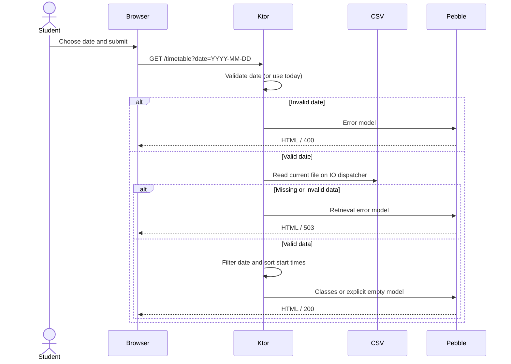

# Requirements and design

## Agreed story

Must Have; T-Shirt size L. A first-year undergraduate balancing five modules needs a reliable daily timetable showing all classes, start/end times, module codes and rooms in chronological order, to plan the day and attend on time.

**Happy path:** Given scheduled classes for a selected day, opening Daily Timetable displays all of them chronologically with start/end times, module codes and room numbers.

**Sad path:** Given timetable data cannot be retrieved, opening Daily Timetable displays a clear error instead of an empty or misleading schedule.

**Sprint goal:** Enable students to view their daily timetable with accurate class times and locations so they can plan their day and attend classes on time.

**Personal development goal:** Improve Kotlin/Ktor skills through implementation, testing, course learning materials and teammate code review through GitHub. The implementation supports this goal; learning and review must be evidenced personally.

## MVP mapping

| Requirement | Implementation |
| --- | --- |
| Default today | London-local date calculated per request |
| Date selection / future weeks | GET date form, seven day links, previous/next week |
| Required details and chronology | Validated LocalDate/LocalTime, date filtering, sorted cards |
| Useful context | Module name and class type; Today link |
| Empty date | HTTP 200 and explicit no-classes message |
| Missing/unreadable/malformed CSV | HTTP 503 and clear retry guidance; no partial timetable |
| Invalid date | HTTP 400 and correction guidance |
| Mobile/desktop | Responsive CSS, wrapping controls, readable cards |
| Honest data provenance | Visible demo notice, data coverage dates, fictional rooms/classes |

The story's automatic school synchronisation remains a **known limitation**. Reading an updated local CSV on each request is not real school synchronisation. No login, personal accounts, editing, SQL, maps, notifications or Outlook integration. Gap calculations are an optional idea and are not implemented; class times make gaps visible without additional complexity.

## Wireframe

```text
UniLeeds / Mini Project                         Demo timetable

Daily Timetable
Find your next class. Make time for everything in between.

[Date picker] [Show timetable] [Today]   Previous week / Next week
[Mon] [Tue] [Wed] [Thu selected] [Fri] [Sat] [Sun]

Thursday, 26 November 2026                            3 classes
09:00–10:00 | MODULE CODE / Lecture
            | Module name / Room
11:00–12:00 | ...
14:00–16:00 | ...

Fictional sample-data notice / coverage dates / Leeds time
```

On small screens date controls wrap, week controls move below the form and cards retain time beside course details. Error/empty panels replace the class list rather than competing with it. A labelled native date field, visible keyboard focus, a skip link, semantic headings and lists, and `aria-current` indicate selection without relying solely on colour.

## Request sequence



## Technical decisions

Two Kotlin files keep the project understandable. Pebble follows the course's template chapter and escapes data automatically. CSV is outside the static resource directory. Known data errors are handled without exposing paths, raw records or stack traces. No fallback timetable masks a failed read. A no-store response lets new requests reflect current data. File reading runs on the IO dispatcher.

The CSV format is intentionally limited and documented; a general CSV library is unnecessary for the controlled seven-field sample data. All records are validated, including records on unselected days, so corrupt data is reported consistently.
